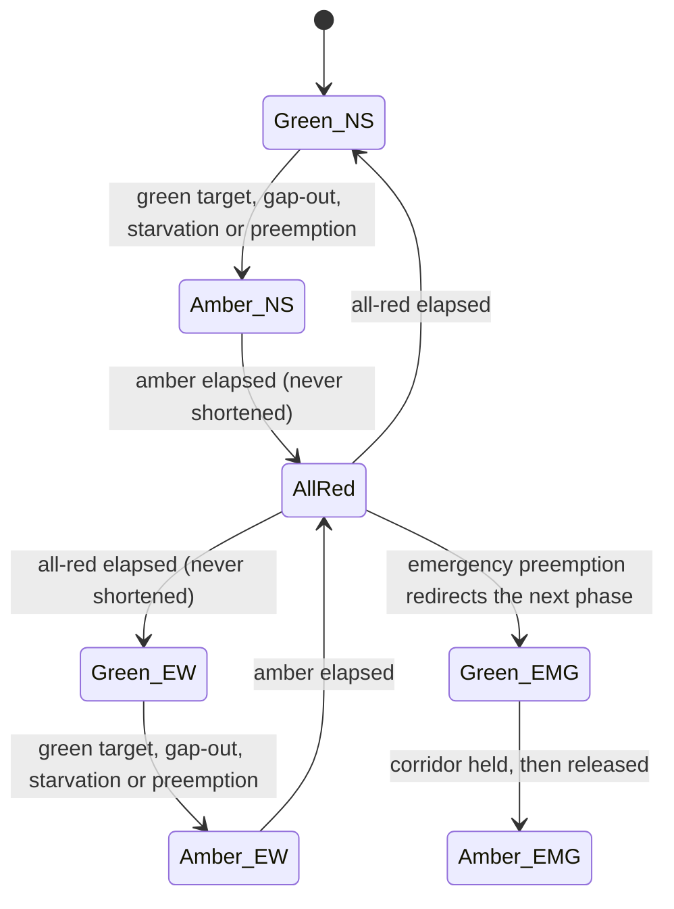

# Architecture

JunctionLab is one file, `index.html`, split into two halves by a marker pair.

## Core / view split

```text
// ==CORE-START==
   constants, seeded RNG, class Sim      <- no DOM access, ever
// ==CORE-END==
   canvas drawing, DOM, controls
```

`Sim` never touches `document`, `window` or `requestAnimationFrame`. That single constraint is what lets
`test/core.test.js` and `scripts/benchmark.js` slice the core out of the HTML and run thousands of
simulated minutes under Node. It also means the published numbers describe the shipping code.

## Fixed time step

The simulation advances in fixed `DT = 1/60` s ticks, decoupled from the render loop. The frame loop
accumulates wall-clock time and drains it in whole ticks, so 8× speed runs more ticks per frame rather
than bigger ones. Physics therefore behave identically at every speed, and a run is reproducible from
its seed alone.

## Seeded randomness

Each approach has its own `mulberry32` stream, offset by direction index, so changing one arm's demand
cannot perturb another arm's arrival sequence. This is what makes the "same vehicles, different
controller" comparison legitimate.

## Signal state machine



Two phases only: north–south and east–west. `lamp(axis)` is the single source of truth for what a
driver sees. `clearLog` records the realised duration of every amber and all-red so a test can prove
none of them was truncated.

## Amber commit rule

When a lamp turns amber a vehicle decides once, and never re-decides:

```text
stop   if  distance-to-line >= v² / (2 · comfortable-deceleration)
go     otherwise
```

A vehicle that commits to stop is clamped behind the line for the rest of the phase. The statistic
`committedCrossed` exists purely to prove that clamp holds, and the suite asserts it is zero.

## Derived clearance intervals

Amber is `reaction + v / (2a)`; all-red is `(junction width + vehicle length) / clearance speed`.
Both are computed from scene constants through one pixels-per-metre scale factor, so changing the
scene scale changes the timings. Emergency preemption may truncate **green**, never amber or all-red.
An axis whose green was cut short is recorded as owed and must receive at least its minimum green on
its next turn.

## Adaptive control

Each tick the controller weighs an axis in passenger-car units (`PCU_TABLE`: two-wheeler 0.5, car 1.0,
auto-rickshaw 0.8, bus 2.5) over approaching plus off-screen vehicles, then applies, in order:

1. never shorter than `MIN_GREEN` (6 s), never longer than `MAX_GREEN` (30 s);
2. **gap-out** after `GAP_OUT` (1.6 s) with no arrival, so an empty phase is not held;
3. **priority hand-over** when the other axis carries `PRIORITY_RATIO` times the queue and this green
   has already run `PRIORITY_WAIT_S`;
4. **starvation protection**: a waiting axis starts green within `STARVE_S` (60 s), with the trigger
   firing early enough to pay for its own clearance interval.

## Webster plan

`websterPlan()` computes `Co = (1.5L + 5) / (1 − Y)`, where `L` is lost time across both phases and
`Y` the sum of the two critical flow ratios, rounds up to a multiple of 5 s, and splits green
proportionally with a 6 s floor. Above `Y ≥ 0.95` the junction is oversaturated: the plan degrades to
equal greens and says so on screen.

Saturation flow is measured, not assumed. `calibrateSaturation()` builds a saturated queue behind a red
lamp in a throwaway `Sim`, releases it, and counts departures per second of green.

## Car following

Longitudinal motion is an Intelligent-Driver-Model-style acceleration — standstill gap `S0`, desired
headway `TGAP`, comfortable braking, maximum braking — followed by a per-lane position relaxation pass
that forbids overlap.

## Safety checker

`checkSafety()` compares the axis-aligned box of every vehicle pair each tick and counts a collision
once per pair, keyed by vehicle id, so a sustained overlap is one event rather than sixty per second.
Together with the red-run counter and the amber-commit counter, that is the invariant the whole project
is built around: **0 collisions and 0 red-light runs in every scenario.**
